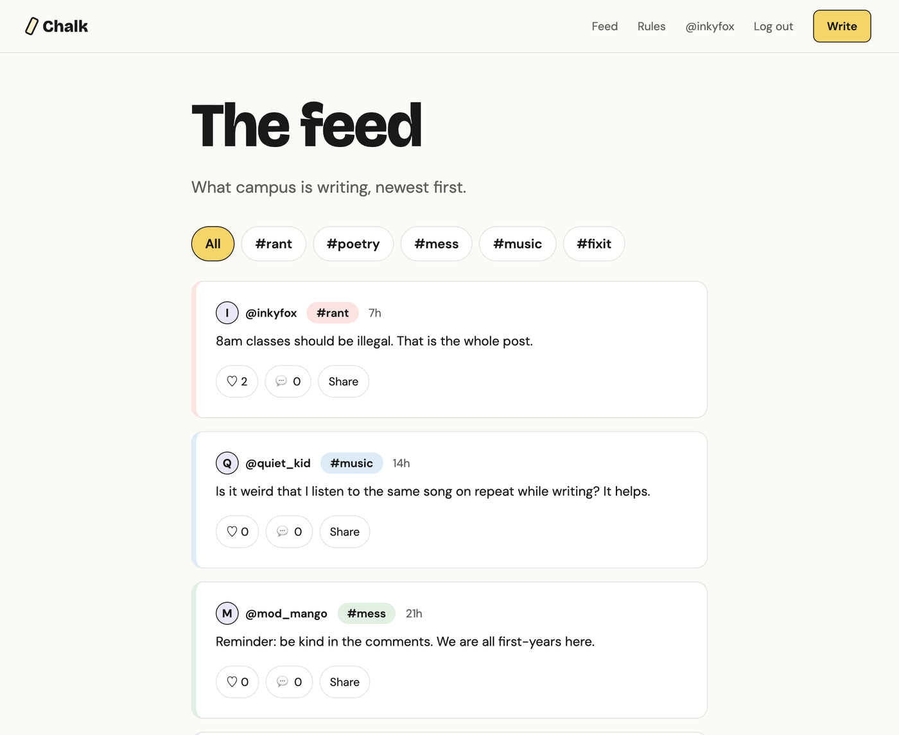

# Chalk

**A campus writing space.** Write about anything (a rant, a poem, a half-finished thought, the song stuck in your head, the tap that's been broken since August) under a name you choose.

Chalk is built by the students of the open source guild. It's small on purpose, so it can be your **first real open source contribution**.

**Live:** https://chalk-client.vercel.app


---

## What Chalk does

- **Write posts** with a label:

  | Label | For |
  |---|---|
  | `#rant` | Letting it out |
  | `#poetry` | Verse, free or otherwise |
  | `#mess` | Half-thoughts and doodles in words |
  | `#music` | What's on repeat, and why |
  | `#fixit` | Something on campus that needs fixing |

- **A shared feed** of everyone's posts, newest first, filtered by label.
- **Like, comment and share** posts. Sharing opens your phone's share sheet, or copies the link.
- **Follow people** and see a profile's followers and following. The feed has a *Following* filter.
- **Your own profile page** with a photo, a bio and a **theme**. Each theme is one CSS file, and anyone can add a new one.
- **Accounts** with email and password, email verification, and "forgot password".
- **Moderators**, chosen by the admin, can remove posts and comments that break the [rules](public/rules.html).



### How names work

- You sign up with your email address. It's never shown on the site.
- You post under a **handle** you choose. Everyone else only sees the handle.
- The people who run Chalk's database (not moderators) can see which email is behind a handle, and only look in serious cases.
- It's a nickname, not a mask. On a small campus, people may still recognise how you write.

---

## Run it on your laptop

You need:

- [Git](https://git-scm.com/downloads)
- [Node.js](https://nodejs.org/) **22.18 or newer** (check with `node --version`)
- [Docker Desktop](https://www.docker.com/products/docker-desktop/), installed and running (it runs the database)

Want to contribute? Fork the repository first and follow the [contributing guide](docs/CONTRIBUTING.md) instead. To just try Chalk:

```bash
git clone https://github.com/BeNikk/Chalk.git
cd Chalk
npm install
npm run setup     # starts the database, creates the tables, adds fake users and posts
npm run dev       # starts Chalk at http://localhost:3000
```

Open **http://localhost:3000**. You don't need any accounts or API keys:

- **Log in as a fake user**: `inkyfox@chalk.test` (or `chalk_admin`, `mod_mango`, `mess_hall`, `lofi_leela`, `quiet_kid`, all `@chalk.test`), password **`chalk-dev-password`**. `chalk_admin` is the admin and `mod_mango` is a moderator.
- **Emails** (verify, reset password) are printed in the terminal running `npm run dev`. Copy the link from there.
- **Profile photos** are saved in the `uploads/` folder.

`npm run dev` restarts the server whenever you save a file. Refresh the browser to see your change.

### Commands

| Command | What it does |
|---|---|
| `npm run setup` | First-time setup. Running it again resets your data to the fake data. |
| `npm run dev` | Starts Chalk and restarts it when you save |
| `npm test` | Runs the tests (needs the database from `npm run setup`) |
| `npm run lint` | Checks the code and the themes for mistakes |
| `npm run db:update` | After pulling new code: adds any new tables to your database (keeps your data) |
| `npm run db:seed` | Resets your data to the fake users and posts |
| `npm run db:studio` | Opens a page to browse the database |
| `npm run db:migrate -- --name what_changed` | After changing `prisma/schema.prisma`: updates the tables |
| `docker compose down` | Stops the database (your data stays) |

Something went wrong? See [If setup goes wrong](docs/CONTRIBUTING.md#if-setup-goes-wrong). Stuck on the code? The [help pages](docs/help/README.md) explain every idea used in the code, from CSS variables to sessions.

---

## How the code is organised

```
public/                  the website: plain HTML, CSS and JavaScript (no build step)
  *.html                 one file per page: index, feed, post, write, profile, settings, login…
  css/                   base.css (variables), layout.css (where things go), components.css (how things look)
  js/api.js              every request to the server goes through here
  js/pages/              one small script per page
  themes/                profile themes, one CSS file each
  illustrations/         the drawings of people
server/                  the API (Express)
  routes/                which address runs which controller
  controllers/           what each request does
  models/                all database code (Prisma)
  services/              passwords, email, photos, tokens
  middleware/            login checks, input checks, uploads, rate limits, errors
  schemas/               what each request must look like (Zod)
prisma/                  schema.prisma (every table), migrations, seed.js (fake data)
tests/                   the tests, one file per part of the API
docs/                    contributing guide, help pages, deployment guide
```

The website only talks to the server through its JSON API (`/api/...`, listed in [docs/help/api.md](docs/help/api.md)), so anyone can build another client against it: a Telegram bot, a CLI, a phone app.

### Tech

- **Frontend:** plain HTML, CSS and JavaScript modules. No frameworks, no build step.
- **Backend:** Node.js, Express 5, Prisma (ORM) with PostgreSQL, Zod, bcrypt, cookie sessions.
- **Services:** Supabase (database), Resend (email), Cloudinary (photos), Vercel (hosting). See [docs/DEPLOYING.md](docs/DEPLOYING.md).
- **Checks:** ESLint, Node's test runner with Supertest, GitHub Actions on every pull request.
- **Fonts:** [Bricolage Grotesque](https://fonts.google.com/specimen/Bricolage+Grotesque), [DM Sans](https://fonts.google.com/specimen/DM+Sans), [Caveat](https://fonts.google.com/specimen/Caveat).

### Design in one paragraph

Calm and clean, like a notebook: an off-white background, near-black text, big bold headings, thin borders and lots of space. Color comes from soft pastel tints (one per label) and the yellow main button. Hand-drawn people from [Open Peeps](https://www.openpeeps.com/) appear around the site and wobble when you hover over them. The quirky stuff goes on profile pages, through themes.

---

## Contributing

New to open source? Good, this project is for you.

Read the **[contributing guide](docs/CONTRIBUTING.md)**. It walks you through setting up, picking an issue, making a change you understand, and opening your first pull request.

Good places to start:

- Issues labelled [`first-timer`](https://github.com/BeNikk/Chalk/labels/first-timer) or [`good-first-issue`](https://github.com/BeNikk/Chalk/labels/good-first-issue)
- Making a profile theme (see [docs/help/themes.md](docs/help/themes.md))
- Adding your own drawing (see [`public/illustrations/README.md`](public/illustrations/README.md))

Ideas for new features are welcome as a separate discussion.

---

## Credits and license

- Illustrations: [Open Peeps](https://www.openpeeps.com/) by Pablo Stanley, released under CC0.
- Built by the students of our open source guild.
- Code released under the [MIT License](LICENSE).
